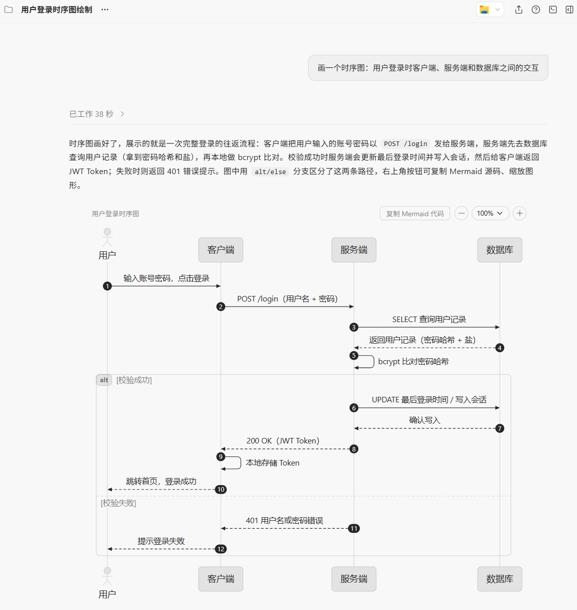

# pele-mermaid

让对话中的 Mermaid 图直接"画"出来：安装本插件后，当回复需要展示 Mermaid 图（流程图、时序图、ER 图等）时，会用 [Pele](https://pele.run/)（Obsidian 官方 Mermaid 渲染库）把它渲染成主题化的内联 SVG，直接显示在对话里，而不是一段裸 `mermaid` 代码块。



上图中用户只说了一句"画一个时序图……"，插件便渲染出完整的用户登录时序图：图形上方自带标题栏，右侧有"复制 Mermaid 代码"按钮和缩放控件，主题自动跟随对话外观。

## 功能特性

- **内联渲染** — 图通过 `::visualize` 指令嵌在回复正文中应出现的位置；每张图的样式与脚本按唯一根 ID 作用域隔离，多图同屏互不干扰。
- **亮/暗自适应** — 主题跟随对话外观自动切换；单独导出查看时可加 `--theme dark|light` 固定。
- **复制 Mermaid 代码** — 每张图右上角自带复制按钮，内嵌该图源码，一键取回（宿主禁用剪贴板时自动展开源码框供手动复制）。
- **缩放控件** — `−/+` 步进按钮与百分比下拉（50%/100%/200%）、适应窗口、重置缩放，范围 25%–400%，放大超宽时图形区域横向滚动。
- **图类型齐全** — flowchart、sequenceDiagram、classDiagram、stateDiagram、erDiagram、pie、gantt、journey、mindmap、timeline、quadrantChart、gitGraph 等。
- **优雅回退** — 遇到 Pele 不支持的语法时先简化重试，仍失败则回退为普通 `mermaid` 代码块并说明原因；环境缺 Node 时同样自动回退。

## 安装

本插件发布在 [xiangyuio/zcode-plugins](https://github.com/xiangyuio/zcode-plugins) 市场中：

1. 按仓库根 README 的[如何安装](../../README.md#如何安装)添加 `xiangyuio-zcode-plugins` 市场；
2. 在市场中找到 **Pele Mermaid 渲染**（pele-mermaid），点击安装。

## 使用

安装后自动生效，无需手动调用。当对话中出现"画图 / 可视化 / 出图 / 流程图 / 时序图"之类请求，或任何回复需要展示 Mermaid 图时，技能会自动触发渲染。例如直接说：

> 画一个时序图：用户登录时客户端、服务端和数据库之间的交互

不适合的场景：当你正在把 Mermaid 当**文本编辑**（写改 `.mmd` 文件、审查语法、教学代码本身）时，插件不会拦截，回复按普通代码处理，需要配图时再另行渲染。

## 环境要求

- ZCode 桌面客户端（需支持会话内联可视化目录；不支持时生成的 HTML 片段会以普通链接给出）。
- Node ≥ 18（运行渲染脚本；缺失时自动回退为代码块）。

## 工作原理

```text
plugins/pele-mermaid/
├── .zcode-plugin/plugin.json     # 插件清单
├── skills/pele-mermaid/SKILL.md  # 技能定义：何时渲染、渲染步骤与回退策略
├── scripts/
│   ├── render-pele.mjs           # 自包含渲染脚本（pele 已打包，克隆即用）
│   └── vendor/pele-LICENSE.txt   # pele 的 MIT 许可文本
└── assets/preview.png            # 本文档的效果截图
```

渲染流程：模型把 Mermaid 源码写入会话可视化目录的 `.mmd` 文件 → 调用 `scripts/render-pele.mjs` 生成同名 HTML 片段 → 在最终回复中以 `::visualize` 指令内嵌。`.mmd` 源文件会保留在可视化目录，便于后续修改重渲。

## 开发

渲染逻辑源码位于仓库 `src/pele-mermaid/render-pele.src.mjs`。修改后在 `src/pele-mermaid/` 下运行：

```bash
npm install && npm run build
```

重新生成自包含 bundle（即本目录的 `scripts/render-pele.mjs`），同步许可文本，递增版本号后提交。

## 许可

打包分发的 [Pele](https://pele.run/) 遵循 MIT 许可，版权归 Obsidian 所有，全文见 [scripts/vendor/pele-LICENSE.txt](./scripts/vendor/pele-LICENSE.txt)。
